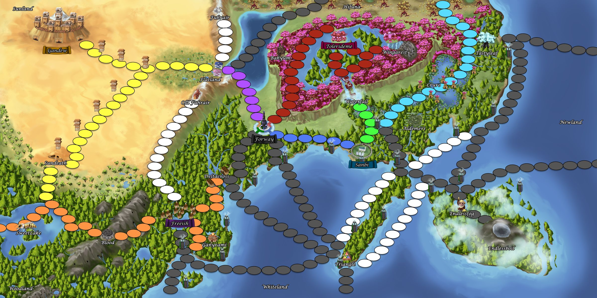

# Maps

## The West March travel map

The table map for the West March: the world map with **circles drawn along the roads and sea lanes connecting places**. Each road has its own colour so you can follow it across the map.

- **Full size, for printing:** [Vraki World Map - West March.png](Vraki%20World%20Map%20-%20West%20March.png) (8000 × 4000, 34 MB). It's a 2:1 map: print it 24 × 12 in, 36 × 18 in or bigger.
- **For screens:** [2400 px](web/west-march-map-2400.jpg) and [5000 px](web/west-march-map-5000.jpg) copies. The website has the map with zoom and pan.

### How to use it
1. **Count the circles** between where the party is and where it's going. Count every circle on the way. A circle next to a town counts for every road that leaves from it, and where two roads share circles (like the two green circles just north of Sanbi), count them on both.
2. **Each circle is 1, 2 or 3 days of travel. The DM chooses**, trip by trip, to make the journey shorter or longer. Forway to Sanbi is 6 circles: 6 days at Fast, 12 at Standard, 18 at Slow.
3. **Keep a shared copy** and mark the circles your parties have traveled or explored. DMs can draw new circles as parties push into unknown land.

Full rules: [Travel by Circles](../D&D%20Campaign/01%20-%20Travel%20by%20Circles.md).

## Route lengths
How many circles each road or sea lane on the map takes. For a trip through several places, add up the legs (Forway → Sanbi → Cruro is 6 + 10 = 16 circles). The encounter table is a suggestion for which [Events & Encounters](../D&D%20Campaign/07%20-%20Events%20&%20Encounters.md) table to roll on; switch it when a trip crosses into other country.

| From | To | Circles | On the map | Encounter table |
|---|---|---|---|---|
| Forway | Sanbi | 6 | blue | Forway Plains & Roads |
| Forway | Flatland | 7 | purple | Forway Plains & Roads |
| Forway | Deltacross | 7 | grey | Forway Plains & Roads |
| Forway | Bahyum | 9 | red | Buhraies Plains |
| Forway | Triangle | 14 | grey, past Forway's lighthouse | Sea & Islands |
| Bahyum | Tolerideme | 4 | red | Buhraies Plains |
| Tolerideme | Wingarest | 3 | red | Buhraies Plains |
| Tolerideme | Waterfall | 3 | red | Buhraies Plains |
| Waterfall | Wingarest | 4 | red | Buhraies Plains |
| Sanbi | Waterfall | 5 | green | Sanbi Coast & Swamps |
| Sanbi | Cruro | 10 | green, then light blue | Sanbi Coast & Swamps |
| Waterfall | Cruro | 10 | green, then light blue | Sanbi Coast & Swamps |
| Cruro | Tastyleaf | 5 | light blue | Sanbi Coast & Swamps |
| Tastyleaf | Hifuna | 6 | light blue, to the north edge | Hifuna & the Far North |
| Flatland | Gandew | 10 | yellow | Desert |
| Flatland | Sundeath | 18 | yellow | Desert |
| Gandew | Sundeath | 19 | yellow | Desert |
| Flatland | Fuhrair | 5 | white | Desert |
| Flatland | Hifuna | 11 | grey, across the lake to the north edge | Hifuna & the Far North |
| Old Fuhrair | Freeish | 13 | white | Freeish Forests |
| Sundeath | SweetLake | 8 | yellow, then orange | Freeish Forests |
| Sundeath | Blood | 10 | yellow, then orange | Freeish Forests |
| SweetLake | Blood | 8 | orange | Freeish Forests |
| Blood | Freeish | 4 | orange | Freeish Forests |
| Freeish | Deltacross | 5 | orange | Freeish Forests |
| Freeish | Ganyrami | 3 | orange | Freeish Forests |
| Deltacross | Triangle | 12 | grey | Sea & Islands |
| Freeish | Triangle | 15 | grey, along the south coast | Sea & Islands |
| Ganyrami | Triangle | 14 | orange, then grey | Sea & Islands |
| Sanbi | Endlessfog | 13 | green, then grey | Sea & Islands |
| Sanbi | Triangle | 17 | green, grey, then white | Sea & Islands |
| Sanbi | Tastyleaf | 27 | green, grey, white, then grey up the east coast | Sea & Islands |
| Triangle | Endlessfog | 15 | white, then grey | Sea & Islands |
| Tastyleaf | Endlessfog | 21 | grey, down the east coast | Sea & Islands |
| Endlessfog | Endlessboil | 2 | grey | Sea & Islands |

### Off the edge of the map
These lanes run off the map. The count is to the edge; the DM decides how far the rest is.

| From | Heading | Circles to the edge |
|---|---|---|
| Tastyleaf | east, toward Newland | 7 |
| Endlessfog | east, toward Newland | 12 |
| Triangle | south | 3 |
| Freeish | south-west, along the coast | 8 |
| SweetLake | west | 2 |

A white lane also branches south from the Sanbi–Endlessfog lane (where it meets the Triangle lane) and ends in open sea after 11 circles.

## World maps
The [#HusbandOutWorld repo](https://github.com/Deovandski/HusbandOutWorld/tree/main/Legacy/Behind%20The%20Scenes/Illustrations/World%20Map) has the full-resolution world map (with and without names), the metadata map (populations, altitudes, villages), a Sanbi city map, embassy art, and the global map of the western continent. The metadata map's kilometer labels are canon, but you don't need them at the table.

Map © Deovandski Skibinski Junior · CC-BY-NC-SA-4.0
